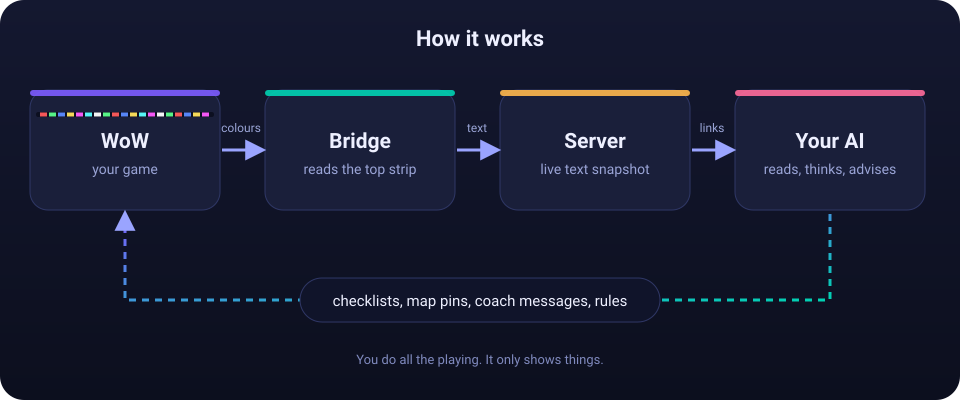
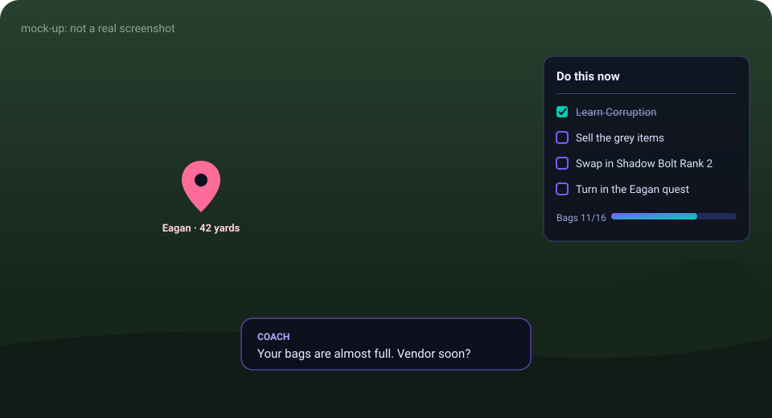
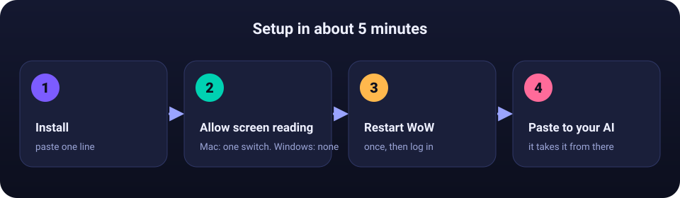

<h1 align="center">WoW Mentor</h1>
<p align="center"><b>An AI coach that sees your WoW game and puts advice right on your screen.</b><br>
Mac + WoW Forever. You play, it watches and helps.</p>

<p align="center"></p>

## What you get

- Your AI sees your game live: where you are, quests, bags, gear, bars, fights, deaths.
- It draws small panels in your game: checklists, progress bars, map pins, coach messages.
- Instant in-game rules, like "warn me when my bags are almost full".
- It can read and edit your Guidelime guide (with backups).
- It never presses a key, clicks, casts or moves for you. Display only.

<p align="center"></p>

## Setup

<p align="center"></p>

**1. Install.** Open Terminal and paste:

```bash
curl -fsSL https://raw.githubusercontent.com/PhilipAD/wow-mentor/main/install.sh | bash
```

**2. Allow screen reading.** System Settings > Privacy & Security > Screen & System Audio Recording > add and turn on **WoW Mentor Bridge**.

**3. Restart WoW** (Cmd+Q, relaunch, log in). Needed once.

**4. Check it, then hand it to your AI:**

```bash
wowmentor doctor
wowmentor links
```

Copy the text `links` prints and paste it to your AI. Treat it like a password.

Stuck? `wowmentor doctor` tells you what to fix. More: [QUICKSTART](docs/QUICKSTART.md), [TROUBLESHOOTING](docs/TROUBLESHOOTING.md), [FAQ](docs/FAQ.md).

## Or let an AI do the setup

Paste one of these. Swap anything in `<ANGLE BRACKETS>` for what your agent tells you.

<details>
<summary><b>Prompt 1: an agent on your Mac (Claude Code, Codex, ...) installs it for you</b></summary>

```text
Set up WoW Mentor on this Mac for me. Repo: https://github.com/PhilipAD/wow-mentor

Rules: never print my private links or secrets back in chat, never post them anywhere, don't touch my WoW
character data, and don't send keys or clicks to the game. Stop and ask me when a step needs my hands.

1. Check: this is macOS, `python3 --version` is 3.9+, and WoW Forever is installed
   (ls "/Applications/World of Warcraft"). If something is missing, tell me how to fix it and wait.
2. Download https://raw.githubusercontent.com/PhilipAD/wow-mentor/main/install.sh, read it, tell me in 3 lines
   what it does, then run it.
3. Open the Screen Recording settings for me:
   open "x-apple.systempreferences:com.apple.preference.security?Privacy_ScreenCapture"
   Ask me to turn on "WoW Mentor Bridge". Wait for my OK.
4. Ask me to fully quit WoW (Cmd+Q), start it, and log in to a character. Wait for my OK.
5. Run `wowmentor doctor` (if the command is not found, use ~/.wowmentor/app/wowmentor.sh doctor).
   Fix every warning it explains, then run it again until it is clean.
6. Run `wowmentor links`. Use the skill link in its output to read your operating skill, then put a short
   plan on my screen with the wowui command. Do not paste my links back to me.
7. Finish with a 5-line report: what passed, what I still need to do.

Only if I ask for a remote AI (a website or another computer) to coach me: explain that this exposes my
links to the internet, wait for a clear yes, then run `wowmentor share on` and tell me to run
`wowmentor links` for the new links.
```

</details>

<details>
<summary><b>Prompt 2: a remote bot (Grok, a web chatbot, ...) becomes your live coach</b></summary>

First on your Mac: `wowmentor share on`, then `wowmentor links`. Copy the three links into the placeholders below.

```text
You are my live World of Warcraft coach. Read everything below before you reply.

My links (private, do not repeat them in chat):
  SKILL  <SKILL_URL>      your operating manual: read it first, it is the source of truth for every command
  FEED   <FEED_URL>       my live game as text (add ?t=<random number> to avoid caching)
  EVENTS <EVENTS_URL>     what just happened: <EVENTS_URL>?since=<last seq>

Set up, in this order:
1. Read SKILL. If you can run shell commands, install the `wowui` command as it says, then run
   `wowui brief` (and again after any context reset). If you cannot run commands, use the HTTP
   endpoints it lists instead.
2. Read FEED. Check SESSION_STATE first: if it is not in_world, tell me and wait. Never act on stale data.
3. In one short message, tell me what you can see (zone, bars, bags, gear) and what you will help with.
4. Put 3 to 5 in-game rules in place for the things you would otherwise nag me about (bags, durability,
   missing buffs, lower-rank spells on my bars). Check the RULES section to confirm they loaded.
5. Optional, instant mode: if you can be woken by a webhook, give me the URL, the key and how your
   Authorization header starts, in a place I can copy. I will then run:
     wowmentor webhook set <WEBHOOK_URL> --bearer -
   (use --auth "<exact header value>" if it does not start with Bearer), then `wowmentor webhook test`.
   If you cannot, keep polling EVENTS: it works without a webhook.

How to work:
- Poll EVENTS with ?since=<last seq>. React to deaths, fights, quest and loot events, window_open
  (merchant, trainer, quest reward), lower_rank_on_bar, and my /coach questions. Answer those with
  wowui coach "<answer>" --answer <question id>. No ack on a message means I have not seen it.
- Talk to me with wowui coach "<text>" (add --toast if it is urgent). Keep panels small and at the edges.
- Use ACTIONBARS, TARGET, FIGHTS, DEATHS, ITEMS (BoE green or better is marked KEEP FOR AH),
  REWARDS and TRAINER. If a value says unknown, say so. Never invent data.
- Overlay writes: always send an opId, use partial for batches, and read the reply for rejected ops.
- Never show my level or XP on screen (you may use them to think).
- You cannot and must not press keys, click, move, target, cast, loot, accept quests, or equip anything.
  Advise only.
```

</details>

## How it works (30 seconds)

1. A small **addon** draws a hairline strip of coloured squares at the top edge of the WoW window. That is your game data, written as colours.
2. A **bridge** on your Mac reads those pixels (read-only), turns them back into text, and hides the strip from your own eyes.
3. A **local server** shares that text with your AI and takes its advice back to the game.

Why pixels? WoW does not let addons write files or open connections while you play, so the screen is the one live way out. Details: [HOW-IT-WORKS](docs/HOW-IT-WORKS.md).

## Privacy and safety

- Nothing leaves your Mac until you run `wowmentor share on`, set a webhook, or give your links to an AI.
- Your links hold long random secrets. Anyone with a link can read your game or draw on your screen. `wowmentor rotate-secrets` makes new ones.
- No screenshots are saved. Other players' chat is left out unless you turn it on.
- It cannot cast, move, target or press keys. It only shows things.

More: [PRIVACY](docs/PRIVACY.md), [SECURITY](SECURITY.md).

## Good to know

- macOS and the **WoW Forever** client only.
- One WoW restart after the first install.
- The game hides some numbers in combat (exact health and mana), and things like auction prices and other players' gear.
- Overlay updates can take a few seconds to show up. Guide edits need `/reload`.
- Early release: if something is off, please [open an issue](https://github.com/PhilipAD/wow-mentor/issues).

## Docs

| | |
| --- | --- |
| [QUICKSTART](docs/QUICKSTART.md) | Slow, step by step install |
| [FAQ](docs/FAQ.md) / [TROUBLESHOOTING](docs/TROUBLESHOOTING.md) | Quick answers and fixes |
| [AGENT](docs/AGENT.md) | Connecting Claude Code, Codex or a bot |
| [RULES](docs/RULES.md) | Instant in-game rules and webhooks |
| [FEED](docs/FEED.md) | Every data section your AI gets |
| [FOREVER-API](docs/FOREVER-API.md) | What the game does and does not allow |
| [CONTRIBUTING](CONTRIBUTING.md) / [CHANGELOG](CHANGELOG.md) | Help build it, see what changed |

## Disclaimer

Independent, unofficial project. **Not affiliated with or endorsed by Blizzard Entertainment.** World of Warcraft is a trademark of Blizzard Entertainment, Inc. It only reads the game window and never sends keyboard or mouse input, but Blizzard has not reviewed tools like this and its rules can change. Use at your own risk. Provided "as is" under the [MIT License](LICENSE). Credits: [NOTICE](NOTICE).
